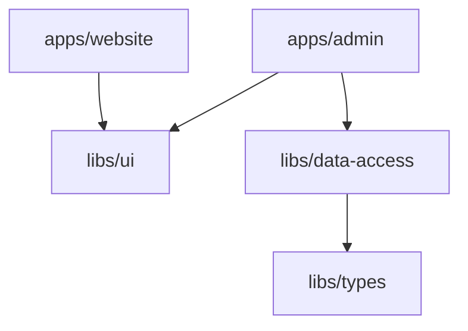

### Paso 1: Generar la librería de UI para Angular

Ejecuta el generador oficial de Nx para librerías Angular en la carpeta `libs/ui`:

```bash
npx nx g @nx/angular:library libs/ui
```

Esto generará automáticamente:

- El proyecto en [`libs/ui`](file:///c:/workspace_node/nx/ejemplo-nx/libs).
- El alias en [tsconfig.base.json](file:///c:/workspace_node/nx/ejemplo-nx/tsconfig.base.json):
  ```json
  "@org/ui": ["./libs/ui/src/index.ts"]
  ```
- Configuración de testing con Jest y linting con ESLint.

---

### Paso 2: Trasladar el componente a la nueva librería, por ejemplo app-nx-welcome

1. Mueve o crea el archivo en `libs/ui/src/lib/nx-welcome.ts` (puedes tomar el de `apps/website` o `apps/admin`).
2. Asegúrate de que acepte el título por `@Input()` para que cada app personalice su encabezado:
   ```typescript
   // libs/ui/src/lib/nx-welcome.ts
   import { Component, Input, ViewEncapsulation } from '@angular/core';
   import { CommonModule } from '@angular/common';

   @Component({
     selector: 'app-nx-welcome',
     imports: [CommonModule],
     template: `...`,
     styles: [...],
     encapsulation: ViewEncapsulation.None,
   })
   export class NxWelcome {
     @Input() title = '';
   }
   ```
3. Exponlo en el punto de entrada público [libs/ui/src/index.ts](file:///c:/workspace_node/nx/ejemplo-nx/libs):
   ```typescript
   export * from './lib/nx-welcome';
   ```

---

### Paso 3: Eliminar los archivos duplicados en las apps

Elimina las copias locales que venían por defecto en cada aplicación:

- `apps/admin/src/app/nx-welcome.ts`
- `apps/website/src/app/nx-welcome.ts`

---

### Paso 4: Importar el componente compartido en las aplicaciones

En el componente raíz de cada aplicación, actualiza el import para usar `@org/ui`:

#### En [apps/admin/src/app/app.ts](file:///c:/workspace_node/nx/ejemplo-nx/apps/admin/src/app/app.ts) y también en los tests:

```typescript
import { Component, inject } from '@angular/core';
import { RouterModule } from '@angular/router';
import { NxWelcome } from '@org/ui'; // <-- Import desde la librería compartida
import { ProductService } from '@org/data-access';

@Component({
  imports: [NxWelcome, RouterModule],
  selector: 'app-root',
  templateUrl: './app.html',
  styleUrl: './app.css',
})
export class App {
  protected title = 'admin';
  ...
}
```

#### En [apps/website/src/app/app.ts](file:///c:/workspace_node/nx/ejemplo-nx/apps/website/src/app/app.ts) y también en los tests:

```typescript
import { Component } from '@angular/core';
import { RouterModule } from '@angular/router';
import { NxWelcome } from '@org/ui'; // <-- Import desde la librería compartida

@Component({
  imports: [NxWelcome, RouterModule],
  selector: 'app-root',
  templateUrl: './app.html',
  styleUrl: './app.css',
})
export class App {
  protected title = 'website';
}
```

Y en sus plantillas HTML (`app.html`), pásale el título:

```html
<app-nx-welcome [title]="title" /> <router-outlet></router-outlet>
```

#### A posteriori en libs/ui/tsconfig.lib.json

Se añade rootDir y sourceMap

```typescript
"compilerOptions": {
  "outDir": "../../dist/out-tsc",
  "rootDir": "src",
  "declaration": true,
  "declarationMap": true,
  "inlineSources": true,
  "sourceMap": true,
  "types": []
}
```

#### A posteriori en libs/ui/tsconfig.spec.json

Se añadió "rootDir": "."

```typescript
  "compilerOptions": {
    "outDir": "../../dist/out-tsc",
    "rootDir": ".",
```

#### A posteriori en libs/ui/eslint.config.mjs

En los prefix se añade 'app'

```typescript
prefix: ['lib', 'app'],
```

#### En tsconfig.base.json

Se eliminó "declarationMap": true,

---

### Paso 5: Sincronizar y Validar el Grafo

1. **Sincronizar referencias de TypeScript**:

   ```bash
   npx nx sync
   ```

   Nx actualizará automáticamente las referencias de proyecto (`project references`) en `apps/admin/tsconfig.app.json` y `apps/website/tsconfig.app.json`.

2. **Validar el grafo de dependencias**:
   ```bash
   npx nx graph
   ```
   Verás visualmente cómo tanto `admin` como `website` apuntan ahora a la librería compartida `ui`:



3. **Verificar que todo compile y pase pruebas**:
   ```bash
   npm exec -- nx run-many -t build,lint,test
   ```
